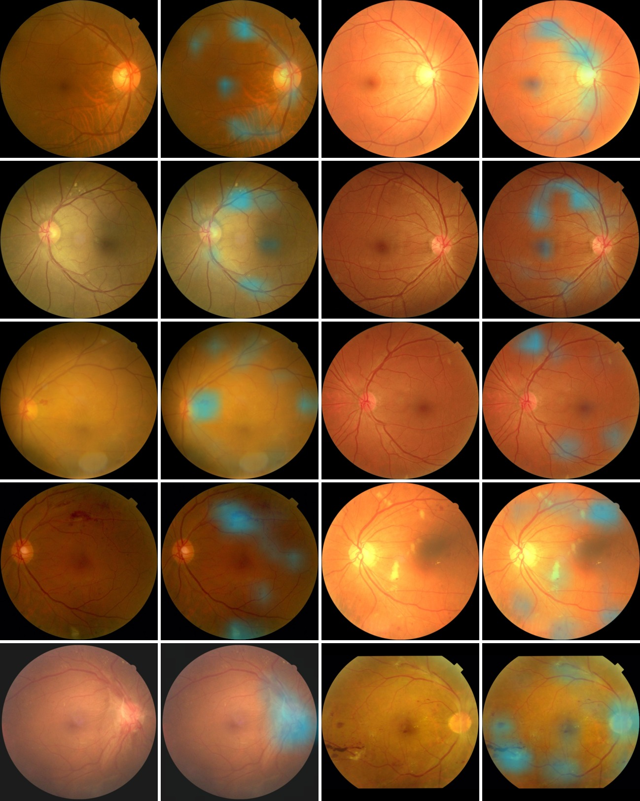

# Explainable AI for diabetic retinopathy grading on MMRDR

This repository holds the code for the Aston University and Boots Opticians KTP practical assessment. A ResNet50 model grades colour fundus photographs (CFP) from the MMRDR dataset into five diabetic retinopathy (DR) grades, and Grad-CAM heatmaps show which areas drove each prediction.

The work checks for leakage between the official training and test sets, fixes the model selection rule before testing, and analyses errors, reliability and the heatmaps themselves. It is a research prototype, not a clinical tool.

## Main results

The chosen model is ResNet50 at 512 pixels (best epoch 10). It was tested once, on the 2,225 official test photographs. The intervals are 95% bootstrap intervals from 1,000 resamples.

| Measure | Test result |
|---|---|
| Accuracy | 0.763 (0.744 to 0.782) |
| Macro F1 | 0.649 (0.622 to 0.672) |
| Quadratic weighted kappa (QWK) | 0.880 (0.862 to 0.896) |
| Referable DR sensitivity (grade ≥ 2) | 0.701 (0.668 to 0.738) |
| Referable DR specificity | 0.972 (0.963 to 0.979) |
| Expected calibration error | 0.025 |

Sending the 19.4% of test photographs closest to the referral boundary for review caught 151 of the 192 missed referrals and 12 of the 13 severe or PDR photographs that the model called mild or No DR.

## Repository layout

    configs             training settings for the three candidate models
    scripts             the pipeline, one script per step, run in order from 00 to 09
    src                 shared code for data loading, models, metrics, calibration, plots and Grad-CAM
    splits              split_assignment.csv, the split used for every photograph
    results             example figures, tables and summaries from the full run
    requirements.txt    package versions

The scripts write everything they produce into the data and outputs folders. Neither folder is part of the repository.

The trained model files are not included either. The fine-tuned RETFound model is 1.18 GB, well over GitHub's 100 MB limit for a single file, and the RETFound weights are shared only under the authors' licence, which asks every user to accept their conditions on Hugging Face. The ResNet50 models, at 92 MB each, were left out to keep the repository small. Step 5 recreates all three.

| File in src | What it holds |
|---|---|
| data.py | Reads the split file, builds the image transforms and the dataset class |
| models.py | Builds ResNet50 or RETFound, loads and checks the RETFound weights, builds the optimiser |
| metrics.py | Accuracy, macro F1 and QWK, computed the same way everywhere |
| calibration.py | Temperature scaling and the expected calibration error |
| plots.py | Confusion matrix, reliability diagram and review curve |
| explain.py | Grad-CAM, the weight reset for the sanity check, retina mask, blurring for the faithfulness test, overlays |

## Requirements

- Python 3.14. The results were produced with Python 3.14.6.
- An NVIDIA GPU is strongly recommended. The results were produced on a laptop RTX 3080 with 8 GB of memory. ResNet50 at 512 pixels reserved about 4.7 GB and RETFound about 6.1 GB.
- About 30 GB of free disk space, made up of 18.6 GB for the download, 7.6 GB for the extracted photographs, and the rest for preprocessed photographs and model checkpoints.

## Installation

    python -m venv .venv
    .venv\Scripts\activate
    pip install torch==2.13.0 torchvision==0.28.0 --index-url https://download.pytorch.org/whl/cu130
    pip install -r requirements.txt

## Data

The dataset is not included here. Download and extract it in two steps.

1. Download the nine archive parts, MMRDR.zip.001 to MMRDR.zip.009 (18.6 GB in total), into one folder from https://figshare.com/articles/dataset/MMRDR/29423747. The dataset is released under CC BY 4.0 and described in Tang et al., Scientific Data, 2026, https://www.nature.com/articles/s41597-026-07005-9.
2. Run step 00 with the command in the next section. It reads the nine parts as one archive, so 7-Zip is not needed. It extracts only the colour fundus photographs and the documentation, and checks every file as it goes.

After step 00, the data folder looks like this.

    data/MMRDR-CFP/FP.csv      grade, 7 lesion flags and eye for every photograph
    data/MMRDR-CFP/img         11,118 photographs, names starting with tr for training (8,893) and ts for testing (2,225)

## RETFound weights

These weights are only needed for the RETFound comparison. The model YukunZhou/RETFound_mae_natureCFP is gated on Hugging Face and released under CC BY-NC 4.0, so it may not be used commercially.

1. Accept the conditions on the model page, https://huggingface.co/YukunZhou/RETFound_mae_natureCFP.
2. Create an access token with read permission.
3. Log in once with the command hf auth login.

The training script then downloads the 3.95 GB file by itself. Keep the token out of the code and out of the repository.

## Reproducing the results

Run every command from the repository root. Each script's default paths match the layout above.

    # 0. extract the colour fundus photographs from the nine downloaded parts
    python scripts/00_extract_data.py --parts PATH_TO_THE_DOWNLOADED_PARTS --out data

    # 1. inspect the data, photographs per grade, lesion flags, label checks and image sizes
    python scripts/01_inspect_data.py

    # 2. find copies of the same photograph across training and test, using vessel fingerprints
    python scripts/02_find_duplicates.py

    # 3. remove training copies of test photographs and draw the validation set
    python scripts/03_make_splits.py

    # 4. crop to the retina, pad to a square, resize to 768 pixels and measure image quality
    python scripts/04_preprocess.py

    # 5. train the three candidates, compare them and choose with the fixed rule
    python scripts/05_train.py --config configs/resnet50_224.yaml
    python scripts/05_train.py --config configs/resnet50_512.yaml
    python scripts/05_train.py --config configs/retfound_224.yaml
    python scripts/05b_compare_runs.py
    python scripts/05c_select_model.py

    # 6. evaluate the chosen model on the test set, once
    python scripts/06_evaluate.py

    # 7. error analysis
    python scripts/07_error_analysis.py

    # 8. reliability, covering calibration, the review rule and image sharpness
    python scripts/08_reliability.py

    # 9. Grad-CAM heatmaps, the sanity check and the faithfulness test
    python scripts/09_explain.py

Useful options, if you want to try them.

- Adding --smoke to the training command runs one tiny epoch to check that everything works.
- Adding --override changes any setting without editing the config file, for example --override epochs=5 batch_size=8.
- Adding --run retfound_224 to the evaluation command evaluates another finished run for context. Use it only after the choice in step 5 is made.

Step 3 rewrites splits/split_assignment.csv. With the same data and seed, the file should come out identical to the committed copy.

The table gives the training time for 20 epochs on the RTX 3080 laptop GPU.

| Run | Time | Best epoch |
|---|---|---|
| ResNet50, 224 pixels | 17.8 minutes | 15 |
| ResNet50, 512 pixels | 61.4 minutes | 10 |
| RETFound, 224 pixels | 85.4 minutes | 15 |

## What each step should report

The table gives the validation results at each model's best epoch, on 1,262 photographs.

| Model | Parameters | Accuracy | Macro F1 | QWK |
|---|---|---|---|---|
| ResNet50, 224 pixels | 23.5M | 0.726 | 0.632 | 0.861 |
| ResNet50, 512 pixels | 23.5M | 0.786 | 0.690 | 0.902 |
| RETFound, 224 pixels | 303.3M | 0.762 | 0.677 | 0.863 |

The paired bootstrap gave ResNet50 at 512 pixels a QWK lead of 0.041 (0.023 to 0.057) over ResNet50 at 224 pixels and 0.039 (0.020 to 0.055) over RETFound. Both intervals are above zero, so step 5 chooses ResNet50 at 512 pixels.

GPU kernels are not fully deterministic, so a rerun can differ slightly. Two runs of ResNet50 at 512 pixels with the same seed gave validation QWKs of 0.899 and 0.902.

- Step 2 finds that 52 test photographs (2.3%) have a copy in training, and 33 of them are identical files. At a similarity of 0.80 or more, 98.1% of pairs share a grade, while between 0.60 and 0.80 only 52.8% do.
- Step 3 removes 58 training copies, leaving 7,573 photographs for training and 1,262 for validation. The test set keeps its official 2,225 photographs.
- Step 8 shows that temperature scaling did not help on test, with a calibration error of 0.025 before and 0.026 after, so it was not adopted.
- Step 9 gives a median rank correlation of minus 0.043 in the sanity check. Hiding the most highlighted 10% of the retina lowers confidence by 0.255, against 0.034 for a random 10%.

## Seeds

- The validation split uses StratifiedGroupKFold with 7 folds and seed 42 (step 3).
- Training uses seed 42 for Python, NumPy and PyTorch (step 5).
- Bootstrap intervals and model selection use 1,000 resamples with seed 42 (steps 5, 6, 8 and 9).
- The example sheets in steps 2 and 4 use seed 0.

## Example outputs

The results folder holds a copy of the main outputs from the full run.

| Folder | What it shows |
|---|---|
| 02_duplicates | Test photographs beside their most similar training photographs, by similarity band |
| 04_preprocess | Photographs after cropping, padding and resizing |
| 05_model_selection | The selection result and the training history of each candidate |
| 06_test | Every test metric, and the confusion matrix as an image and a table |
| 07_errors | Moderate photographs called mild, and the serious underestimates, with their grades |
| 08_reliability | Reliability diagram, review curve, review table and the image sharpness table |
| 09_explain | Correct examples and serious errors beside their heatmaps, the sanity check and a summary |

## Notes on the split

MMRDR's colour fundus photographs come from the DDR dataset (Li et al., 2019), which has no patient identifiers, so the official split is by photograph and not by patient. Step 2 measured copies of the same photograph. It cannot detect a new photograph of the same eye or the patient's other eye.

From DDR's average of 1.42 photographs per patient, an estimated 30% to 48% of test photographs may share a patient with training. Test scores may therefore be higher than they would be on new patients.

## Acknowledgements and licences

- The data is MMRDR (Tang et al., 2026), released under CC BY 4.0. The example figures in the results folder contain MMRDR photographs and are shared under the same licence.
- The ResNet50 ImageNet weights come from timm (resnet50.a1_in1k).
- The RETFound colour fundus weights come from Zhou et al. (Nature, 2023) and are released under CC BY-NC 4.0. They are not included in this repository.
- The libraries used are PyTorch, torchvision, timm, huggingface_hub, scikit-learn, SciPy, NumPy, pandas, Pillow, matplotlib and PyYAML.
- All code was written for this project, and no external code was copied.

Written by Fawaz Ahmed Dar.
